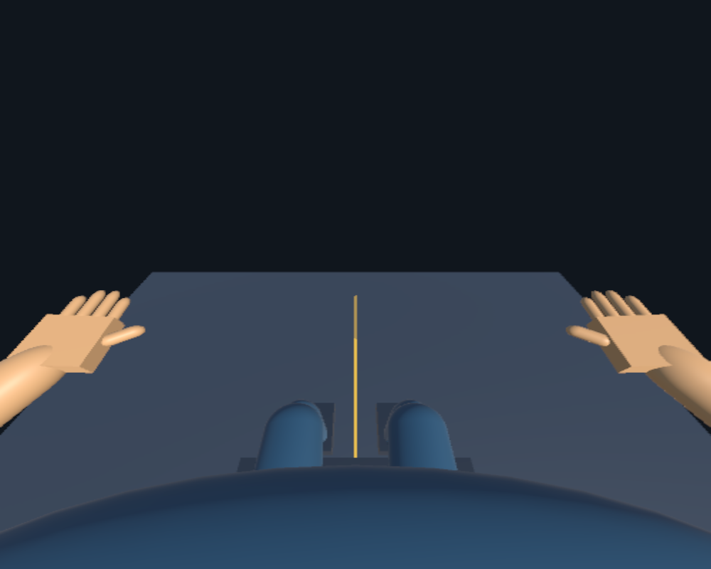
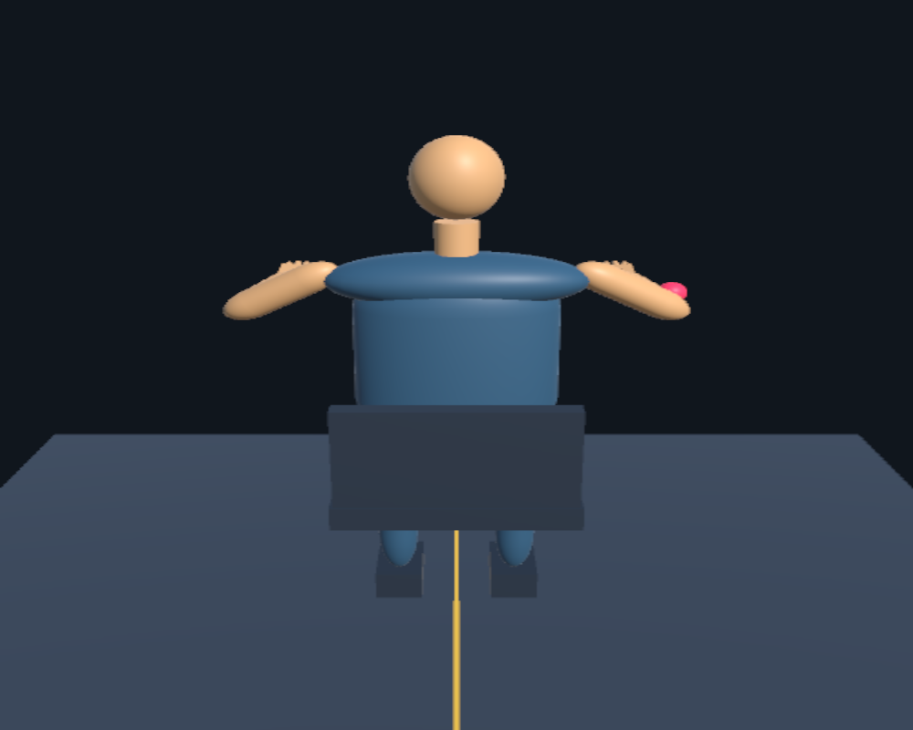

# Class-demo verification — 2026-09-23

This branch is a desktop simulation, not an accepted research milestone.

## Passed

- Unity 6000.6.2f1 imported and compiled the demo scripts in a clean temporary project copy.
- Reflection checks returned PASS with batch process exit 0: position involution, orientation involution, the S R S identity for multiple poses/vectors, and all three condition routes.
- The initial scene was observed running in the Unity Editor with cyan source arms and mirrored gold avatar arms.
- A temporary automated Play-mode harness exercised all three movement modes with a fixed simulated pose.
- Runtime assertions passed for left-to-right, left-to-left, and right-to-left touch routing along the forearm; stop hid the displayed touch marker.
- Both observer and first-person cameras rendered successfully. Images were inspected; shoulder continuity and first-person hand visibility were improved based on that inspection.
- No error stack in the final test log originated in the demo scripts.
- Packages, ProjectSettings, and the original QuestBootstrap scene have no differences from the Milestone 1 commit.

## Remaining editor issue

The temporary batch Play-mode editor emitted an `ArgumentOutOfRangeException` in `UnityEditor.Search.SearchDatabase.EnumerateAll` / `SearchInit.IndexationOnStartup`. The harness deliberately counted that exception and exited with code 1 despite completing the demo assertions. This is **not an entirely clean smoke-test run**. The error was not suppressed or fixed by modifying Unity packages. Its stack points to editor Search indexing, not demonstration code; this does not prove it can never affect interactive use.

Logs are local temporary files: `/private/tmp/quest-class-demo-check.log` and `/private/tmp/quest-class-demo-smoke-final2.log`. The Play-mode harness ran only in the temporary copy and is not part of the application. The committed Reflection Math menu provides repeatable math checks.

## Not verified

- Every control's mouse interaction after the final layout changes; automated checks exercised state and routing, not a complete UI click-through.
- Quest installation, real head/hand tracking, tracking-loss behavior, calibration, clinical suitability, ownership/agency outcomes, or scientific data recording.
- Pixel-perfect layout on every Game-view aspect ratio. Maximize Game view in a landscape layout for class.

## Actual rendered examples

These are renders of the procedural Unity avatar, not headset captures and not concept art. They omit the split-screen controls.

