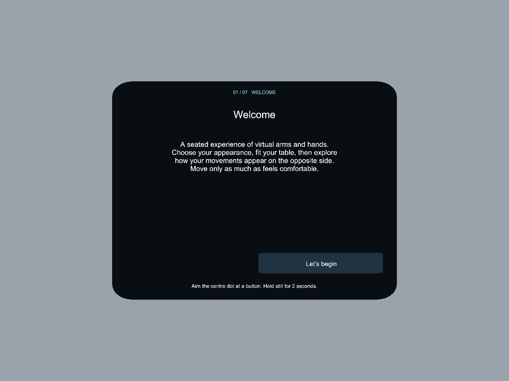
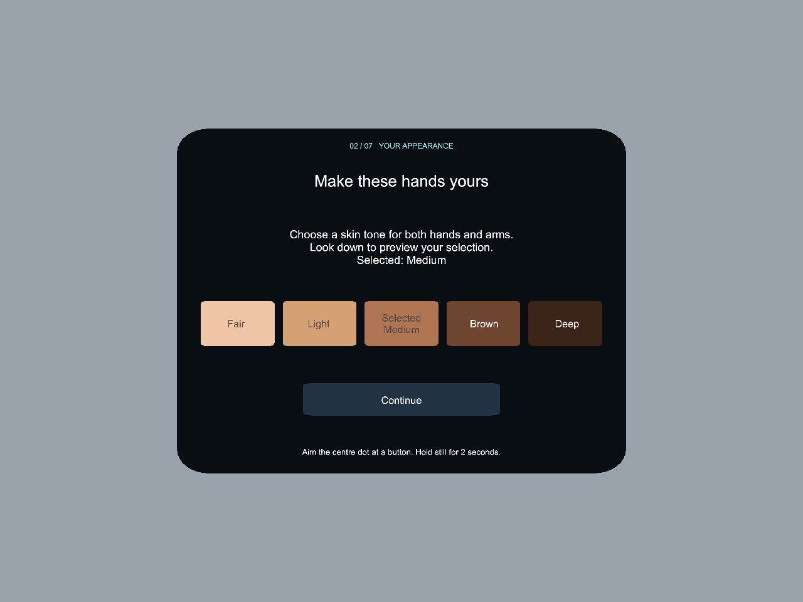
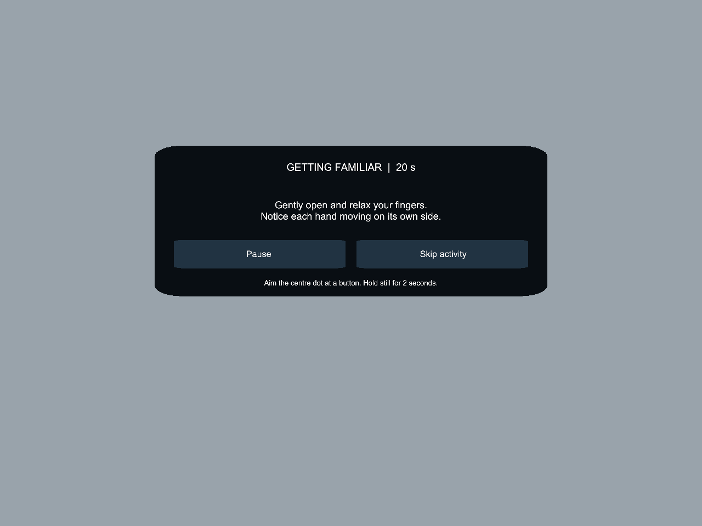

# Guided mirror-therapy demonstration — 0.11.0

Branch: `codex/guided-mirror-pilot`. Unity **6000.6.2f1**, Android/Quest 3.
This is the guided demonstration, not a validated clinical intervention or final scientific recorder.

## Wearer walkthrough

Use **head-directed gaze**, not eye tracking: point the white centre dot at a button and hold for **two seconds**. The button highlights and a circular indicator fills. Move the dot away before selecting again. Pinching does not activate this flow. Controllers are not needed.

1. **Welcome** explains the seated experience. Select **Let's begin**.
2. **Appearance:** choose Fair, Light, Medium, Brown, or Deep. The selected name is shown; both hands and arms receive the same colour. Look down to preview the tracked hands, then Continue. Arms become visible after alignment. These are user-selected display colours, not a skin scan.
3. **Personal fit:** sit comfortably at the real table. Select **Begin alignment**, look forward, and keep your head comfortably still while all UI disappears for four seconds. Rest both palms flat on the real surface when prompted. After a short placement interval, hold still for the table-height estimate. Confirm the virtual surface against the real one. Lower/Raise 1 cm, repeat estimation, adjust the near edge, or enter a measured height in cm/inches if needed. Confirm surface, check the estimated arm fit, and select **Fit looks correct**. Shoulder/elbow positions and arm lengths are estimates, not anatomical measurements. The Quest floor origin comes from its room setup; the table is estimated from instructed resting hands, not scanned.
4. **Familiarisation:** start 20 seconds of normal same-side movement. Two gentle prompts invite finger movement and small hand lifts. Pause or skip any prompt. Then explicitly confirm **I feel ready**; adjust fit or repeat practice if needed.
5. **Mirror experience:** the explanatory screen states the mapping before you begin. Starting automatically selects **SwapBoth**: physical left drives virtual right; physical right drives virtual left. Six prompts last approximately 10 seconds each: fingers, real left hand, real right hand, alternate opening/relaxing, small lift/lower, rest. There is no condition-setting menu. Use small comfortable movements; clapping is not required.
6. **Future touch:** information only. Clinician haptic-glove integration is **to be implemented**. No touch stimulation, touch detection, doctor hand, countdown, or researcher touch-command listener runs in this flow. Haptic gloves will need a separately verified tracking/synchronisation design.
7. **Finish:** resets movement to normal and shows the thank-you/remove-headset message. **New participant** resets the appearance and requires fresh alignment.

During activity, **Pause** opens Resume, Recalibrate, Adjust table, and End demo. Recalibration/table adjustment returns through fitting and normal familiarisation. Hand/body tracking interruptions pause the activity timer; explicitly Resume after stable tracking returns. Headset removal, app pause/focus loss, or head-tracking loss returns to welcome and requires a new fit. Origin invalidation requires alignment again. Long stalled frames do not silently consume a cue.

## UI placement

Setup panels are placed in front of the wearer, above the table workspace, and remain world-fixed while that page is open. Activity prompts use a shorter panel. The card is repositioned on page transitions, not continually attached to head movement. Text uses an overlay shader so scene geometry cannot cut off the buttons. The overlay must still be checked on the headset for comfort and actual hand-workspace clearance across wearer heights. All alignment UI is hidden for four seconds.

## Open, build, and run

1. Open this repository's project folder in Unity **6000.6.2f1** with Android support. Do not open or upgrade the legacy project.
2. Choose **Quest Prototype → Body Avatar → Configure**. This selects `Assets/Scenes/QuestBodyDrivenAvatar.unity`, reconstructs the hand assets from the pinned XR Hands package, and configures the current body-avatar app. Runtime scripts create the environment and guided UI; an empty-looking edit-mode scene is not the running experience.
3. Choose **Quest Prototype → Body Avatar → Build** (or the batch command below). APK: `Builds/QuestBodyDrivenAvatar.apk`. APKs/caches are ignored by Git.
4. Connect an awake Quest 3 with a data-capable USB cable and allow USB debugging. Confirm it appears as `device` in `adb devices -l`.
5. Install with `adb install -r Builds/QuestBodyDrivenAvatar.apk`. Launch **Quest Body Driven Avatar**, package `org.mirrortherapy.questprototype.bodyavatar`.
6. Enable wearer hand tracking and allow body tracking permission if requested. Put controllers aside for the demo. Keep the room well lit and hands visible.

The existing package identifier is retained; `install -r` preserves saved local settings. Every new wearer still goes through fresh alignment and surface confirmation.

```sh
/Applications/Unity/Hub/Editor/6000.6.2f1/Unity.app/Contents/MacOS/Unity   -batchmode -quit -projectPath "$PWD" -buildTarget Android   -executeMethod QuestBodyAvatarSetup.BuildAndPreview   -logFile /private/tmp/guided-build.log
```

`PilotPreview.Render` also renders every UI page in the editor and tests dwell rearming, table-height input, activity timing, and overlay visibility. Existing body-frame reflection, fitted-arm and tabletop correction checks remain. These checks do not substitute for headset acceptance.

## PI-demo acceptance checklist

- Welcome is readable without looking down at the hands; aim/hold instructions are clear.
- Every button highlights and its circle fills; a held gaze fires once. Pinching alone does nothing. Looking off buttons rearms selection.
- Five distinct swatches and a Selected label appear. Both hands and arms keep the chosen colour after calibration and throughout the demo.
- Alignment hides all controls for four seconds and progresses to surface estimation, or explains a failure with a retry.
- Both resting hands and arms remain visibly aligned to the physical table after confirming fit. Correct height before proceeding if not.
- Familiarisation stays congruent, lasts about 20 active seconds, and requires explicit readiness before mirroring.
- Mirror mode starts only after the explanatory screen. Test one physical hand at a time to verify opposite-side control.
- Pause freezes the cue clock. Resume continues it; Skip moves to the next cue. Brief tracking loss pauses with an explanation, and recovery requires Resume.
- Adjust table/recalibrate returns through fit and familiarisation. Menu stays out of the hand workspace.
- Future-touch page is informational only. Finish shows thanks and resets normal mapping.
- Headset removal/new wearer never silently reuses confirmed calibration.

## Engineering event trail

Auto-flushed `pilot-events-*.jsonl` files in the app's persistent data folder record UTC, monotonic app time, app version, stage entry, selected skin tone, mapping, surface settings, calibration actions, activity cue index/elapsed seconds, pauses, skips, resumes and finish. These are engineering/demo events; they are **not** the final research dataset and do not capture full physical/displayed pose streams. No participant identifiers are collected by this guided flow. Affected side is not selected: this demo is the requested bilateral swap demonstration.

## Scope and preserved checkpoints

Tracking providers, body-centred reflection math, arm IK and tabletop correction are preserved. No packages were added. The legacy repository is untouched. The previous manual-touch implementation remains in source/history for reference but is not instantiated or exposed by this guided app. Do not use the old `Tools/touch_control.py` with this version.

Earlier accepted basic pilot is preserved by tags `basic-mirror-therapy-pilot-v0.9.0-tested` and `basic-mirror-therapy-pilot-v0.9.1`. The last manual-touch checkpoint is commit `065e5bf`. Build/UI verification for this guided version is documented in `GUIDED_DEMO_VERIFICATION.md`; wearer acceptance must be recorded separately.

## Interface previews

Editor-rendered interface previews; these are not headset acceptance evidence.






