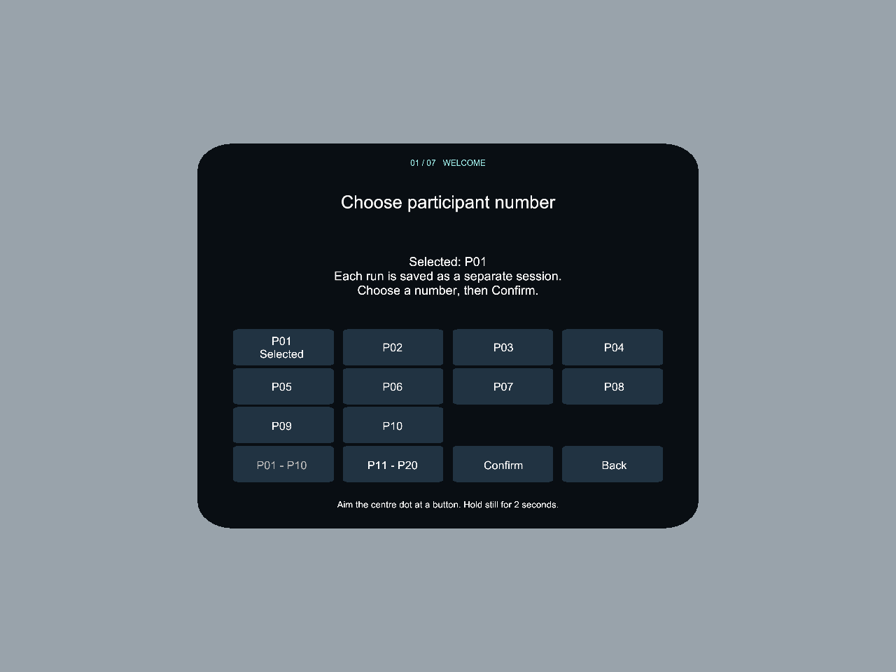

# Participant movement recording — 0.12.0

## Use it

1. Open **Quest Body Driven Avatar**. Select **Let's begin**.
2. Select **P01–P20**, using the P01–P10 / P11–P20 page buttons, then **Confirm**. A large grid is used instead of a tiny dropdown so the existing head-gaze selection remains usable.
3. Check the footer says your ID and **RECORDING**. Recording begins here, including skin selection, calibration, familiarisation and mirrored movement.
4. Complete the guided demo. Finish closes the recording. Removing the headset, losing head/focus tracking or pausing the app ends the session as interrupted; confirming an ID again starts a **new** session. Activity Pause keeps recording stationary/tracked movement and records the paused stage.
5. Keep the Quest USB-connected and debugging-authorized. On this Mac, open **Desktop → Research Movement Data Demo**. The local transfer agent checks every 30 seconds while logged in. With no cable, files remain on the headset and copy after reconnection. The Mac must be awake for transfer.
6. Open `P01/<unique-session>/` (or the selected number). Reusing P01 creates another dated session; nothing is overwritten. `TRANSFER_VERIFIED.json` means all closed-session chunks were copied with SHA-256 checks and their record count matches the headset manifest. Its `recordingStatus` and `reason` still distinguish a finished, interrupted or failed run.

A **Saved on headset** message does not assert that USB transfer has completed. Confirm the Desktop verification marker. You can also double-click **Sync Quest Data Now.command** in the Desktop folder.

## What is recorded

Target: **30 samples per second**, not every sensor update or every display frame. Use actual monotonic timestamps and sample intervals; do not assume exactly uniform 30 Hz. Sampling occurs after avatar update in the before-render callback where available. A labelled LateUpdate fallback records when recent rendering is absent and explicitly invalidates the displayed-pose snapshot.

| Layer | Recorded data | Interpretation |
| --- | --- | --- |
| Physical head | Position and quaternion orientation; tracking flag | XR camera pose in tracking-origin space, not a measurement of eyes |
| Head-directed gaze | Origin and forward direction | The direction used for the menu; **not eye gaze or fixation** |
| Physical left/right hands | All 26 joint positions and rotations, each with validity; source status, update phase, receipt time, age and sequence | XR Hands runtime output; an available joint may be estimated under occlusion |
| Mapped left/right hands | All joint targets, source side, reflection flag and input sequence | Experimental mapping before table/display correction |
| Displayed left/right hands | All final joint poses after display correction; renderer-enabled flags | Final pose supplied to the hand renderer, not pixel visibility, optical measurement or actual screen scan-out |
| Estimated body | Eight existing shoulder/upper-arm/lower-arm/wrist provider poses, validity, location flags, provider time, confidence, calibration/fidelity and origin/skeleton revisions | Meta body estimates; no claim that elbows/shoulders are directly measured |
| Fitted arms | Shoulder/elbow/wrist centreline points, fitted lengths, visibility, table-lift/flattening values | IK/display estimates. Full deformed mesh vertices are not captured; recorded surface-lift values describe the additional mesh correction |
| Context | Participant/session, stage, skin tone, movement mode, calibration/table parameters, body/tracking frame transforms, frame/sample indices and timing | Allows separation of physical input, manipulation and display corrections |
| Events | Stage entry, calibration actions, mapping, cues, pauses, skips, finish and interruption | Same participant/session and monotonic clock as movement samples |

**Quest 3 has no eye-tracking hardware/API for this purpose.** `eyeTrackingAvailable=false` is explicit. There are no pupil, blink, fixation or eye-rotation measurements. There is also no clinician-hand, glove, contact-pressure, pain score, full-body/leg, or physiological recording in this version. No artificial hand-confidence number is fabricated; the numeric confidence belongs only to the body provider.

## Files and coordinate/timing conventions

```text
Research Movement Data Demo/
  P01/
    20261019T123456123Z-<random session identifier>/
      session.json
      movement-000001.jsonl
      movement-000002.jsonl
      ...
      closed.json
      TRANSFER_VERIFIED.json
```

- `session.json`: schema version 1, participant/session, UTC start, app/Unity/device versions, target sampling rate, joint names/order, coordinate definitions, and stopwatch frequency/start. No participant names are requested.
- `movement-*.jsonl`: one JSON object per line. `type=sample` or `type=event`. Read files in numeric order. Every record carries participant and session identifiers.
- Positions are in **metres**. Quaternions use **x,y,z,w**. Physical/mapped/displayed hand poses, head pose and estimated body poses use the XR tracking space. Fitted arm points use the calibrated participant body frame. The world poses of both reference frames accompany samples. Calibration and origin changes must be respected when comparing sessions.
- Invalid poses use `valid=false` with neutral placeholder numbers. Never interpret those numbers as observations. Nonfinite input poses are marked invalid before JSON serialization. An unavailable receipt age is `-1`.
- `monotonicSeconds` is Unity realtime since app start; `stopwatchTicks` is a high-resolution monotonic clock with frequency in metadata. `deltaSeconds` gives actual sampling intervals. UTC appears in metadata/events. Receipt timestamps are **not sensor exposure times**. The separate body-provider clock must not be assumed synchronized with these clocks.
- Source `inputSequence` links mapped/displayed snapshots to their physical hand update; source status/age distinguishes repeated or stale samples. Displayed poses do not prove a particular pixel was visible to the wearer.
- `closed.json` contains closure status/reason, chunk count and total record count. A closure reason of `finished` differs from headset/focus interruption. Absence of this file means active recording or incomplete termination, not a completed trial.

## Saving and failure behavior

Unity snapshots are serialized on the main thread; immutable records go to a **bounded background writer**. Disk work does not run in the rendering callback. The writer flushes to disk at least once per second while active and closes/renames chunks approximately every two seconds. A queue overflow or disk failure stops recording and opens a visible error screen; the app does not silently discard samples and continue claiming to record.

A crash can leave a `.jsonl.partial` tail. Earlier closed chunks remain readable and transferable, so data is not held entirely until Finish. The final buffered tail may be lost. A power interruption is not a guarantee of zero data loss. Normal USB transfer ignores live/partial chunks and never calls them complete. For crash recovery, retain the original headset folder including `.partial`; only complete, valid JSON lines from that tail should be recovered into a separately labelled dataset. Do not concatenate recovered tails with subsequently finalized copies of the same chunk.

Headset files are under:
`/sdcard/Android/data/org.mirrortherapy.questprototype.bodyavatar/files/MovementData/`

The copier never removes headset originals or silently overwrites a conflicting laptop file. Back up/export data before uninstalling the app or clearing its storage. Raw session files stay outside the Git repository and are not uploaded to GitHub by these tools. Use your lab's approved storage and retention process; a participant code is pseudonymous, not a guarantee of anonymity.

## Local transfer service

Installed on this Mac:

- `~/Desktop/Research Movement Data Demo/`
- `~/Library/Application Support/Quest Research Data/sync_movement_data.py`
- `~/Library/LaunchAgents/org.questresearch.movement-sync.plist`

This is a local macOS LaunchAgent, not a cloud upload. `transfer.log` and `transfer-errors.log` are in the Desktop folder. It runs once every 30 seconds while logged in, with a lock preventing concurrent transfers. It requires Python 3.11+ and the installed Unity Android SDK's ADB.

On another Mac, after cloning and configuring the project:

```sh
python3 Tools/install_data_sync.py
```

Run a manual sync from the repository:

```sh
python3 Tools/sync_movement_data.py
```

Stop automatic copying (headset recording remains active):

```sh
launchctl disable gui/$(id -u)/org.questresearch.movement-sync
launchctl bootout gui/$(id -u) "$HOME/Library/LaunchAgents/org.questresearch.movement-sync.plist"
```

Run `python3 Tools/install_data_sync.py` again to enable/reinstall the copier. The installer does not delete collected sessions.

## Optional CSV export

JSONL is the canonical full dataset. To create a long-format CSV of head and all physical/mapped/displayed hand joint poses for a **closed** session:

```sh
python3 Tools/export_movement_csv.py "$HOME/Desktop/Research Movement Data Demo/P01/<session-folder>"
```

This creates `movement-joints.csv` without overwriting an existing export. Invalid positions are blank. The CSV is a subset: body estimates, detailed status and events remain in the original JSONL. At 157 pose rows per sample, long sessions can exceed spreadsheet row limits; use Python/R for larger datasets.

## Verification and next headset check

Automated checks cover participant IDs, writer record ordering/drain, finalization, overwrite protection, background I/O failure, source sequence attribution and invalid-number handling. Transfer tests cover repeated sync, checksum verification, conflicts and ignoring partial chunks. An isolated synthetic fixture was copied through the actual Quest USB connection and passed SHA-256/count verification; it was removed without creating a participant session in the Desktop dataset.

Before using these records scientifically, test a short real session: select an ID, move each hand separately, finish, and verify its Desktop folder. Inspect timestamps, validity, physical-versus-mapped sides and sample rate during normal/mirrored movement. Check that recording does not degrade headset performance. This first data format is inspectable research-prototype data, not a validated scientific acquisition system.

## Participant selector preview

Editor-rendered UI; not a participant dataset.


